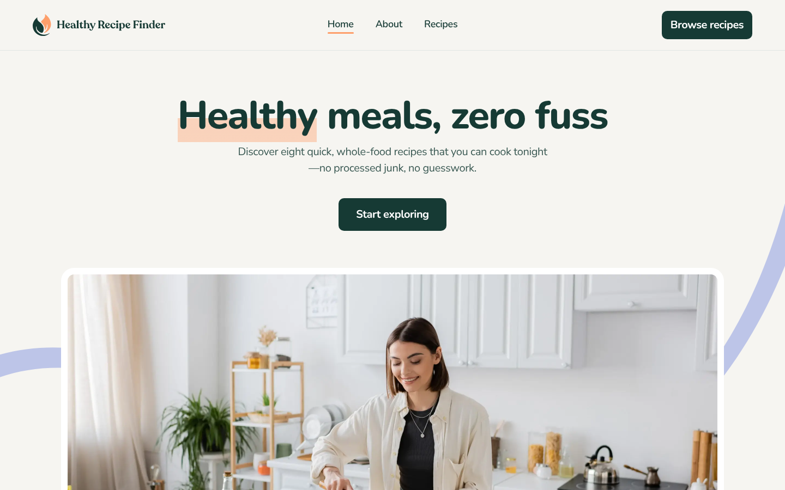

# Healthy Recipe Finder

A responsive recipe-browsing website built with Next.js and Tailwind CSS, based on the Frontend Mentor "Healthy Recipe Finder" challenge and rebuilt to match the Figma design across mobile, tablet and desktop.

**Live site:** [healthy-recipe-finder.pages.dev](https://healthy-recipe-finder.pages.dev)

## Features

- **Home page** with a hero section, three feature highlights, a "Built for real life" section and a call to action.
- **Recipes page** listing eight recipes as cards, with:
  - a **Max Prep Time** filter and a **Max Cook Time** filter (radio-style dropdowns with a Clear option),
  - a **search bar** that matches recipe names and ingredients,
  - filters and search that combine, with a friendly message when nothing matches.
- **Recipe detail pages** (one per recipe) with a breadcrumb, a large photo, servings, prep and cook times, an ingredients list, step-by-step instructions and a "More recipes" section.
- **About page** with the project's mission, "Why we exist", food philosophy and "Beyond the plate" sections.
- **Fully responsive** layouts for mobile (375px), tablet (768px) and desktop (1440px), with a hamburger menu on smaller screens.
- Accessible details: semantic HTML, keyboard-friendly filter dropdowns (Escape closes them), visible focus outlines and descriptive image alt text.

## Tech stack

- [Next.js](https://nextjs.org) (App Router) and React
- [Tailwind CSS](https://tailwindcss.com) v4 with custom design tokens (colours, fonts)
- JavaScript
- `next/font` for Nunito and Nunito Sans, `next/image` for images
- Deployed on [Cloudflare Pages](https://pages.cloudflare.com) as a static export
